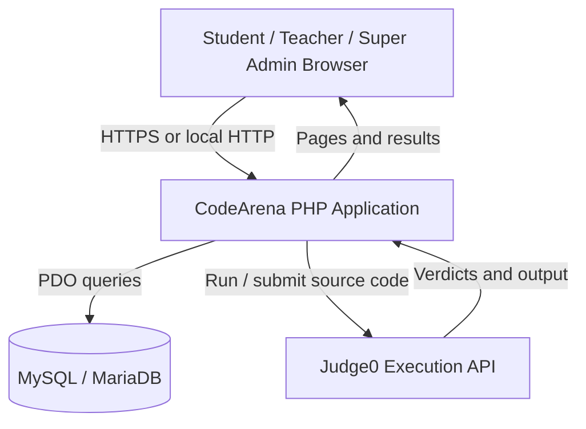

<div align="center">

# CodeArena

### A classroom-focused programming practice and assessment platform

**Create learning paths · Practice code · Assign challenges · Review progress**

[](https://www.php.net/)
[](https://www.mysql.com/)
[](https://judge0.com/)
[](#interface)

**CodeArena** is a web-based learning environment where students practise programming and follow structured learning paths while teachers create exercises, manage classrooms, assign work, and review results. A separate Super Admin portal supports user management and system diagnostics.

[Features](#features) · [Tech Stack](#tech-stack) · [Install](#quick-start) · [Judge0 Configuration](#configure-judge0) · [Testing](#testing-and-diagnostics) · [Security](#security-notes)

</div>

---

## Contents

- [Overview](#overview)
- [Features](#features)
- [Supported Languages](#supported-languages)
- [Tech Stack](#tech-stack)
- [Application Architecture](#application-architecture)
- [Requirements](#requirements)
- [Quick Start](#quick-start)
  - [1. Get the project](#1-get-the-project)
  - [2. Start XAMPP](#2-start-xampp)
  - [3. Create the database](#3-create-the-database)
  - [4. Configure the app](#4-configure-the-app)
  - [5. Create the first Super Admin](#5-create-the-first-super-admin)
  - [6. Open CodeArena](#6-open-codearena)
- [Configure Judge0](#configure-judge0)
- [Add the Learning Paths](#add-the-learning-paths)
- [Portals and Routes](#portals-and-routes)
- [Project Structure](#project-structure)
- [Testing and Diagnostics](#testing-and-diagnostics)
- [Database Migrations](#database-migrations)
- [Security Notes](#security-notes)
- [Troubleshooting](#troubleshooting)
- [Deployment Notes](#deployment-notes)
- [Contributing](#contributing)
- [License](#license)
- [Developer](#developer)

## Overview

CodeArena is designed for programming classes, practice exercises, and teacher-led assessment. It brings the student learning experience and teacher workflows into one PHP application while keeping student, teacher, and Super Admin access separate.

The project is suitable for local development, demonstrations, and academic/capstone projects. **It should be reviewed and tested in your own environment before being exposed to the public internet or used for high-stakes examinations.**

## Features

### Student Portal

- Student registration and sign-in.
- Responsive dashboard with quick links to classes, practice, learning paths, progress, and leaderboard.
- Classroom enrollment with teacher-provided join codes.
- Assigned exercises with timers and server-side deadline checks.
- Explicit **Start Exercise** gate before problem details and the coding workspace are revealed.
- Browser-based code editor with Run Code and Submit Answer workflows.
- Automatic grading against configured test cases, including public samples and hidden cases.
- Score summaries, submission history, progress indicators, and achievements.
- Sequential learning paths: later steps remain locked until prerequisite steps are completed.
- Practice Mode that is separate from official classroom grades.
- HTML/CSS learning projects with browser preview and student-confirmed completion.

### Teacher Studio

- Create, edit, publish, and delete programming exercises.
- Configure difficulty, starter code, point values, time limits in minutes, hints, and test cases.
- Mark sample test cases as public and keep assessment cases hidden.
- Create and manage classrooms, share join codes, and enroll students.
- Assign exercises to classrooms with optional due dates.
- Review gradebooks, submission history, class progress, and analytics.
- Organize learning paths and lessons.
- Provide submission feedback and use the available regrading workflow.
- Review exam-monitoring events, add review notes, and export monitoring records.
- Export gradebook data to CSV where available.

### Super Admin Portal

- Separate Super Admin sign-in and control center.
- Create teacher accounts; public self-registration creates student accounts only.
- Manage users and teacher accounts.
- Review audit events.
- Run System Health diagnostics for PHP extensions, required tables/columns, project files, and Judge0 configuration.
- Access backup, restore, and smoke-test guidance.

### Interface

- Light-mode interface with responsive layouts for desktop, tablet, and mobile.
- Shared typography, spacing, cards, forms, navigation, tables, and focus styles.
- Keyboard-focus and reduced-motion support in the available styles.
- Developer contact link: [GitHub — Benette12416](https://github.com/Benette12416).

## Supported Languages

| Language / Environment | How it runs |
|---|---|
| C | Judge0-compatible execution provider |
| C++ | Judge0-compatible execution provider |
| Java | Judge0-compatible execution provider |
| Python | Judge0-compatible execution provider |
| PHP (CLI) | Judge0-compatible execution provider |
| Ruby | Judge0-compatible execution provider |
| HTML/CSS | Browser preview; not compiled or graded through Judge0 in the same way as the programming languages above |

Language IDs vary by Judge0 provider and deployment. Verify the IDs with your selected provider instead of assuming that the example values in `config/config.example.php` are universal.

## Tech Stack

- **Backend:** PHP 8.1+ using PDO and prepared statements
- **Database:** MySQL 8+ or a compatible MariaDB release
- **Frontend:** HTML, CSS, JavaScript
- **Code editor:** CodeMirror assets loaded by the browser when CDN access is available
- **Code execution:** Judge0-compatible API
- **Local development:** Apache and MySQL through XAMPP

## Application Architecture



Judge0 credentials belong on the PHP server. They must never be included in browser JavaScript or committed to the repository.

## Requirements

- PHP **8.1 or later**
- PHP extensions: `pdo`, `pdo_mysql`, `curl`, and `mbstring`
- MySQL 8+ or compatible MariaDB with InnoDB support
- Apache or another PHP-capable web server
- A reachable Judge0-compatible endpoint and any credentials required by that provider to run code
- Internet connectivity if using CDN-hosted editor assets or a hosted Judge0 API

For the macOS XAMPP instructions below, the default PHP CLI path is `/Applications/XAMPP/xamppfiles/bin/php`.

## Quick Start

### 1. Get the project

Clone your GitHub repository, or download the source ZIP and extract it.

```bash
git clone <your-repository-url>
cd CodeArena
```

For macOS XAMPP, the project folder should be:

```text
/Applications/XAMPP/xamppfiles/htdocs/CodeArena
```

For Windows XAMPP, use:

```text
C:\xampp\htdocs\CodeArena
```

### 2. Start XAMPP

Open XAMPP Manager and start **Apache** and **MySQL**.

Open phpMyAdmin:

- macOS / Windows local URL: `http://localhost/phpmyadmin/`

### 3. Create the database

For a **fresh installation**, import `database/schema.sql` using phpMyAdmin. This script creates the `codearena` database and the tables represented by the current schema.

Alternatively, create a database named `codearena` first, then import the schema into it.

> **Important:** `database/schema.sql` is for a fresh database. Do not import it over an existing installation as a way to upgrade. For an existing CodeArena database, see [Database Migrations](#database-migrations) and apply only the migrations that have not already been applied.

### 4. Configure the app

Copy the example configuration file:

**macOS**

```bash
cd /Applications/XAMPP/xamppfiles/htdocs/CodeArena
cp config/config.example.php config/config.php
```

**Windows PowerShell**

```powershell
Copy-Item config/config.example.php config/config.php
```

Edit `config/config.php`. A default local XAMPP MySQL configuration commonly looks like this:

```php
'db' => [
    'host' => '127.0.0.1',
    'port' => '3306',
    'name' => 'codearena',
    'user' => 'root',
    'pass' => '',
    'charset' => 'utf8mb4',
],
```

Only use an empty MySQL root password for a local development setup where that is actually how XAMPP is configured. Use a dedicated database account with a strong password for a hosted environment.

The example configuration sets `base_url` to `/CodeArena/public`. If the application is installed under a different local folder or the web server's document root points directly to `public/`, update `base_url` to match the deployment.

### 5. Create the first Super Admin

Run the CLI setup script from the project directory. It creates the first Super Admin account and refuses to create additional Super Admins if one already exists.

**macOS XAMPP**

```bash
/Applications/XAMPP/xamppfiles/bin/php tools/create_super_admin.php
```

**Windows XAMPP**

```bat
C:\xampp\php\php.exe tools\create_super_admin.php
```

Follow the prompts and use a strong password of at least 12 characters. Keep the credentials private.

### 6. Open CodeArena

With the default XAMPP folder and `base_url`, open:

| Page | Local URL |
|---|---|
| Public homepage | `http://localhost/CodeArena/public/` |
| Student login | `http://localhost/CodeArena/public/login.php` |
| Student registration | `http://localhost/CodeArena/public/register.php` |
| Teacher login | `http://localhost/CodeArena/public/teacher-login.php` |
| Super Admin login | `http://localhost/CodeArena/public/super-admin/login.php` |
| Help | `http://localhost/CodeArena/public/help.php` |
| About | `http://localhost/CodeArena/public/about.php` |

After signing in as Super Admin, create teacher accounts from the teacher-account management page. Teachers cannot self-register. Students can create their own accounts through public registration.

## Configure Judge0

Open `config/config.php` and configure the `judge0` section. The exact settings depend on whether you use a hosted API provider or a self-hosted Judge0 instance.

Relevant keys:

- `base_url`: the exact base URL supplied by your Judge0 provider.
- `api_key`: the provider API key, if required.
- `auth_header`: the HTTP header name used for authentication, if required.
- `extra_headers`: any additional provider-specific headers, such as the required host header.
- `languages`: the language IDs supported by that provider.

The example config is a template; its example endpoint, key placeholder, and language IDs may need to be changed. Do not assume that all public Judge0 endpoints are available, unlimited, or suitable for production. Follow the endpoint provider's documentation and usage limits.

Run code only through the configured Judge0-compatible service. If Judge0 is unavailable or misconfigured, the application pages may still load, but code execution and grading will fail until the service configuration is corrected.

## Add the Learning Paths

The repository includes these seed scripts:

- `database/seeds/python_foundations_learning_path.sql`
- `database/seeds/all_language_learning_paths_30.sql`

The all-language seed includes seven 30-step paths: Python, C, C++, Java, PHP, Ruby, and HTML/CSS projects. The six programming paths use Judge0-style standard input/output grading; HTML/CSS projects use a browser preview and manual student completion rather than the same automated grading flow.

Before importing a seed:

1. Create at least one Teacher account from the Super Admin portal.
2. Back up your database.
3. Open the seed file and inspect the `@teacher_id` setting near the top. By default it selects the newest teacher account. Set a specific teacher ID if you want the paths owned by another teacher.
4. Import the seed into the `codearena` database using phpMyAdmin.
5. Sign in as that teacher and check **Teacher Studio → Learning Paths**.

The seed files are designed to add missing curriculum content without intentionally overwriting existing exercise text or test cases. Still, back up first and review the seed before importing it into an important database.

## Portals and Routes

| Area | Main route | Purpose |
|---|---|---|
| Public / Practice Arena | `public/index.php` | Public landing page and challenge discovery |
| Student Portal | `public/login.php` and student routes | Classes, assignments, exercises, learning paths, progress, submissions, achievements, leaderboard, and practice |
| Teacher Studio | `public/teacher.php` | Exercises, classrooms, assignments, lessons, gradebook, analytics, submissions, and monitoring |
| Super Admin | `public/super-admin/index.php` | Account management, audit logs, and system health |
| Shared app logic | `app/` | Bootstrap, authentication, layouts, helpers, and Judge0 integration |

## Project Structure

```text
CodeArena/
├── app/                   # Bootstrap, authentication, helpers, layouts, Judge0
├── config/                # Example configuration; local config.php is ignored by Git
├── database/
│   ├── schema.sql         # Fresh-install schema
│   ├── migrations/        # Ordered upgrade scripts for existing databases
│   └── seeds/             # Optional learning-path content
├── public/                # Web-accessible pages and static assets
│   ├── assets/            # CSS and JavaScript
│   └── super-admin/       # Super Admin portal pages
├── tests/                 # Regression, UI, and feature test checklists
├── tools/                 # CLI setup, health, smoke, backup, restore, static checks
├── .gitignore
└── README.md
```

## Testing and Diagnostics

Run static checks from the project root.

**macOS XAMPP**

```bash
cd /Applications/XAMPP/xamppfiles/htdocs/CodeArena
PHP_BIN=/Applications/XAMPP/xamppfiles/bin/php ./tools/check_project.sh
/Applications/XAMPP/xamppfiles/bin/php tools/health_check.php
/Applications/XAMPP/xamppfiles/bin/php tools/smoke_test.php
```

Depending on the feature set in your installation, the repository also includes additional smoke tests and written checklists under `tests/` and `tools/`.

The health and smoke tests may require a configured `config/config.php`, a running database, and the relevant migrations. A static syntax check alone does not prove that SQL queries, browser interactions, or Judge0 submissions work correctly. Complete the browser workflow tests with student, teacher, and Super Admin accounts.

## Database Migrations

`database/migrations/` contains ordered upgrade scripts for legacy installs. The current set includes:

| Migration | Main purpose |
|---|---|
| `001_super_admin_role.sql` | Super Admin role support |
| `002_exam_monitoring.sql` | Exam-monitoring fields and event records |
| `003_classroom_management.sql` | Classrooms, enrollments, assignments, and grades |
| `004_explicit_exercise_start.sql` | Explicit exercise start tracking |
| `005_monitoring_review_workflow.sql` | Teacher monitoring reviews |
| `006_learning_paths_security_audit.sql` | Learning paths and audit/security support |
| `007_exercise_version_history.sql` | Exercise version snapshots |
| `008_html_css_learning_completion.sql` | HTML/CSS project completion records |
| `009_sequential_learning_path_progress.sql` | Sequential learning-path completion tracking |
| `010_lessons_feedback_school_workflows_achievements.sql` | Lessons, feedback, school workflows, and achievements |
| `011_exercise_hints_and_regrade_history.sql` | Hints and regrade history |

For an existing installation, first identify which migrations have already been applied. **Apply only missing migrations, in numeric order, and back up before each upgrade.** Some migration scripts are intended to run once and may fail if applied twice. A fresh installation should import `database/schema.sql` instead of running the whole migration chain over the newly created schema.

## Security Notes

- Never commit `config/config.php`, API keys, real student data, database exports, or passwords.
- Keep Judge0 credentials on the PHP server; never embed them in browser JavaScript.
- In production, configure the web server's document root to the project's `public/` directory so application logic, configuration, tools, and database scripts are not web-served.
- Use HTTPS and secure database credentials outside local XAMPP.
- Keep backups in a location outside the web root and test restoring them into a separate database.
- Review role permissions on server endpoints; hiding a link in the UI is not access control.
- Exam monitoring records browser events such as tab visibility and copy/paste events when the browser exposes them. It cannot reliably stop all external applications or prove cheating by itself. Inform students about monitoring and review events fairly.
- Code execution depends on a separate Judge0-compatible service. Verify the provider's isolation model, usage limits, and data handling before public deployment.

## Troubleshooting

### `Missing config/config.php`

Copy `config/config.example.php` to `config/config.php` and configure it. Do not commit the new local config file.

### `Database connection failed`

Make sure MySQL is running, the database exists, the port is correct, and the credentials in `config/config.php` match your local environment.

### `could not find driver` or `PDO MySQL driver missing`

Enable PHP's `pdo_mysql` extension in the PHP configuration used by XAMPP, then restart Apache. Check the CLI configuration separately if a Terminal health check reports a different extension state.

### `Could not reach Judge0` / host resolution error

Check the exact `judge0.base_url`, internet/DNS access, provider status, API key, auth header, required extra headers, and usage quota. Test the endpoint supplied by your chosen provider; do not assume that an arbitrary public endpoint will remain available.

### Learning paths are missing

Confirm the schema/migrations are current, a Teacher account exists, and the correct learning-path seed was imported. Check that the selected teacher owns the paths and that they are published.

### Page looks unstyled after an update

Hard-refresh the browser: **Command + Shift + R** on macOS browsers. Confirm all updated files under `public/assets/` were copied and that `config/config.php` was preserved.

## Deployment Notes

For public hosting, use a PHP-capable host and a supported MySQL/MariaDB database, or migrate the application deliberately to another database platform. Supabase uses PostgreSQL; it is not a drop-in MySQL database replacement and does not directly host this PHP application. A Supabase migration would require database/query changes and a separate PHP host.

Before accepting real students, verify:

- HTTPS and production-safe PHP error settings.
- Least-privilege database credentials.
- All migrations and smoke tests on a staging database.
- Judge0 connectivity and provider quotas under expected load.
- Backup and restore procedures.
- Student, teacher, and Super Admin permissions.
- Exercise start gate, timer expiry, hidden tests, scoring, regrading, and monitoring flows.

## Contributing

Contributions and issue reports are welcome. Before submitting a change:

1. Describe the problem and the expected behavior.
2. Keep secrets and real student information out of issues, commits, screenshots, and logs.
3. Run `tools/check_project.sh` where supported.
4. Test changes using the relevant student, teacher, and Super Admin roles.
5. Include migration instructions if a schema change is required.

## License

No `LICENSE` file is included in this repository snapshot. If you intend to publish CodeArena as an open-source project, choose a license and add its `LICENSE` file. Until a license is added, do not assume that other people have permission to reuse, redistribute, or modify the code.

## Developer

Created and maintained by **[Benette12416](https://github.com/Benette12416)**.

For questions or feedback, visit the [GitHub profile](https://github.com/Benette12416) or open an issue in your CodeArena repository once it is published.

---

<div align="center">

**CodeArena — Learn step by step. Write code. Test ideas. Grow skills.**

</div>
